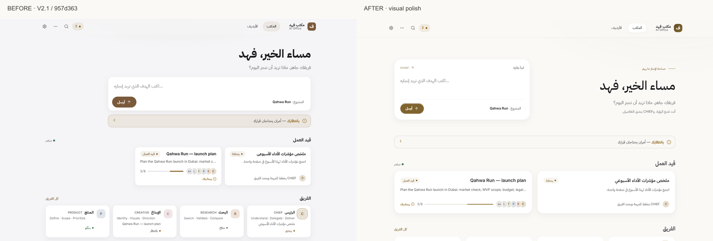
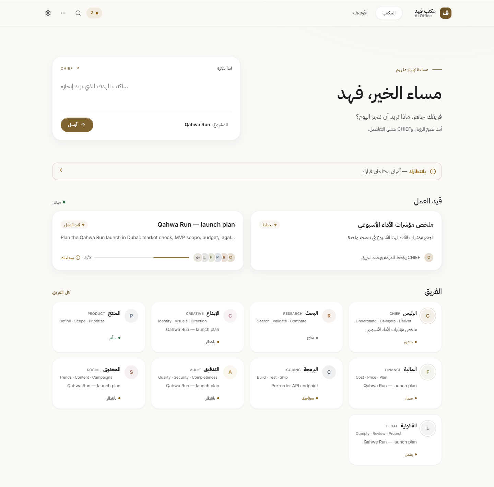
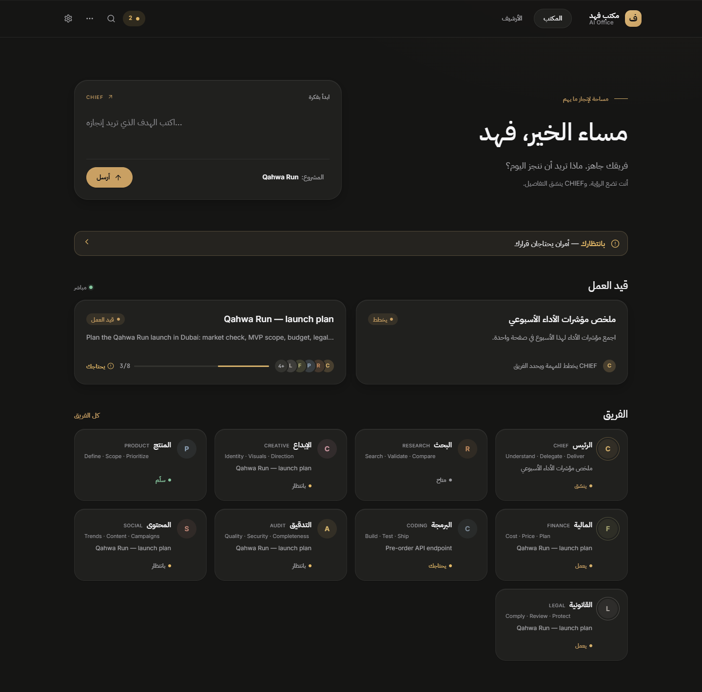
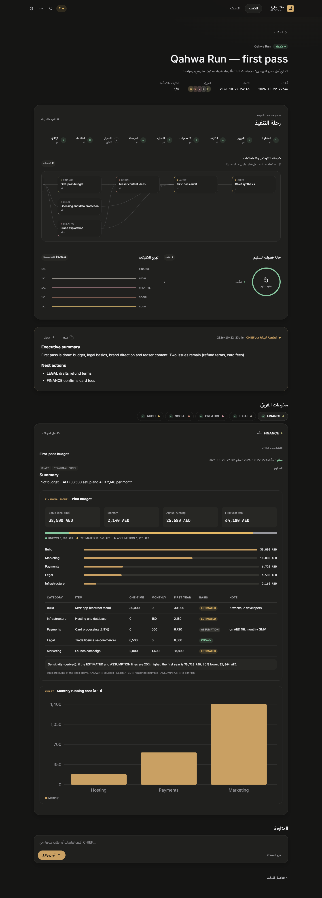
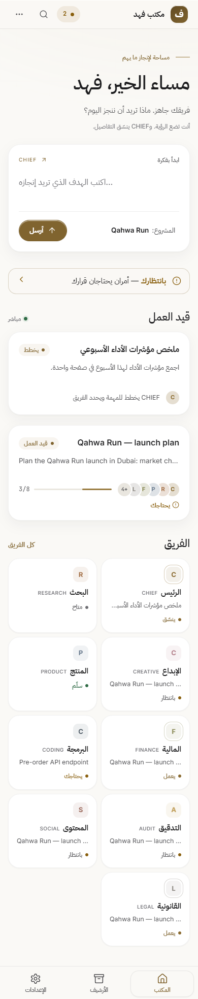
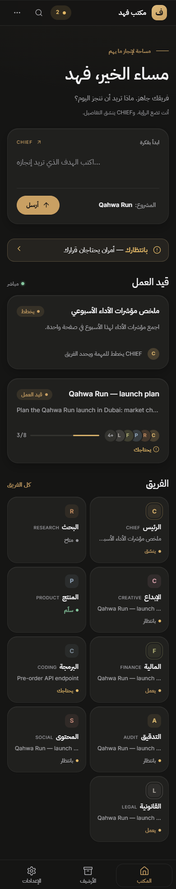
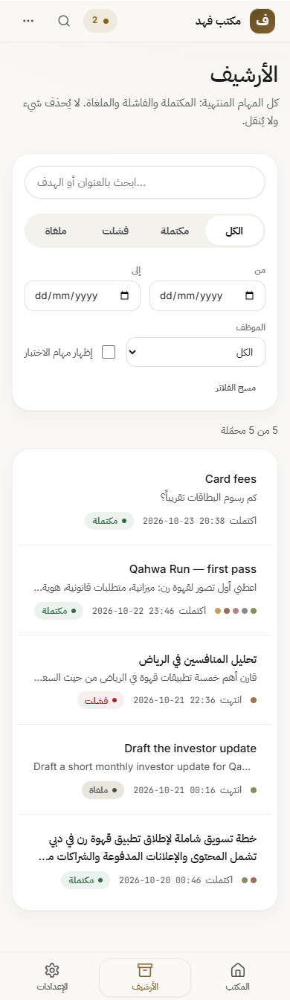
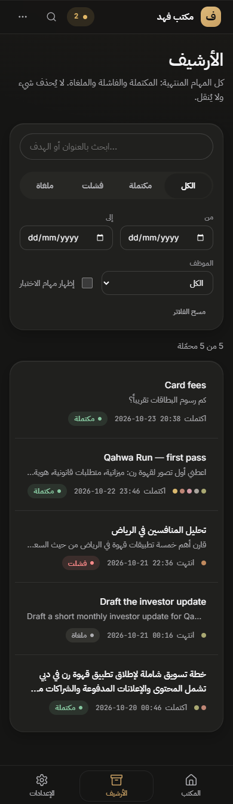

# V2.1 visual polish — review record

UI-only polish on PR #121, continuing `957d36342f9f512bfac0c43327c7afb766ae736e`.
The published base remains `56ff190e432939b0ec573b6807077978a602c46b`.
No merge or deployment is part of this change.

## Before / after

| Area | Before | After |
| --- | --- | --- |
| Office introduction | Compact, right-aligned greeting above a wide input; unused grid space beside active work | Editorial two-column introduction and independent composer; quieter heading, short gold rule, wider active-work cards; one column on phones |
| Light theme | Cool grey canvas and brown accents | Warm porcelain canvas, solid white surfaces and muted gold accents |
| Cards | Tight 16px corners, dense spacing, repeated dashboard shadows | 22–28px corners, larger internal rhythm, lighter employee-card depth and softer borders |
| Execution visuals | Dense nested bordered panels and a status strip | Open composition, thin true-data status ring, aligned count legend, hairline workload bars and lighter dependency paths |
| Overlays | Generic sheet/header and compact dialog | Refined frosted navigation/header/dialog materials, edge highlights, rounded sheet edges and calmer opening/closing motion |
| Archive / Settings | Compact controls and rows | More breathing room, calmer headings, roomier controls, softer selected navigation and consistent surface treatment |

The ring shows each recorded status count divided by the same existing assignment total. Its accessible name includes every displayed status and count. The workflow model, map relationships, node limit, request logic, routes, owner gates and conversation handlers are unchanged.

## Screenshot matrix

The same 26 screenshot views were regenerated in `docs/office-premium-v2.1/`:

- Office, Job Detail, Archive and Approvals: desktop/mobile × light/dark (16)
- employee sheet, approval confirmation, empty Office, planning job and failed job: desktop light/mobile dark (10)

The additional `office-before-after.png` comparison crops the first 900px of the old desktop capture and compares it with the new 1440×900 first viewport. Old screenshots remain available at the previous commit. Fixture timestamps differ between captures; content is local fictional data, not a production reading.

| Light desktop | Dark desktop |
| --- | --- |
|  |  |
|  |  |

| Light mobile | Dark mobile |
| --- | --- |
|  |  |
|  |  |

## Verification

Local Windows / Node 24 / Chrome:

- focused redesign, Hub UI and Office language tests: **38/38 passed**
- existing V2.1 browser verification: **16 axe views, 7 interaction checks**, zero accessibility violations, console errors or page overflow
- screenshot matrix: **26 views**, zero console errors or horizontal overflow
- additional responsive verification: **40 Arabic views** (four primary screens × five widths × two themes) and **10 English Office views**; widths 320, 390, 768, 1024 and 1440px
- chart legend totals equal the ring total; no clipped map-node status labels
- reduced-motion hover has no translation; sheet has no transition; approval dialog has no entry animation
- emulated reduced transparency and high contrast remove navigation blur; sheet Escape and approval cancellation continue to work
- the additional responsive run blocks all external requests and observed **zero external requests / page errors**

The unchanged Linux GitHub Actions workflow remains the full-suite gate, including the runtime build and isolated security/e2e tests. Its current-head result is recorded in PR #121. No tests, CI configuration, security rules or dependencies were changed in this polish pass.

## Boundaries and review limits

Only `src/hub-ui/app.css`, `src/hub-ui/premium.css`, presentation markup in `src/hub-ui/screens.js`, documentation and screenshots change. No backend, API contract, database, migration, Supabase project, workers, providers, prompts, costs or production data were changed or accessed.

Authenticated production screens remain untested because their Supabase OTP boundary is outside scope. Screenshots and interactions use the existing local fictional fixtures through real Hub handlers. Safari, Firefox and physical devices were not tested. The original approved reference image was not present in the retrieved conversation, so this pass follows the specified warm-white direction; these real application screenshots are the basis for visual approval.

**Leave PR #121 open. Fahad's explicit approval is required before any merge or deployment.**
