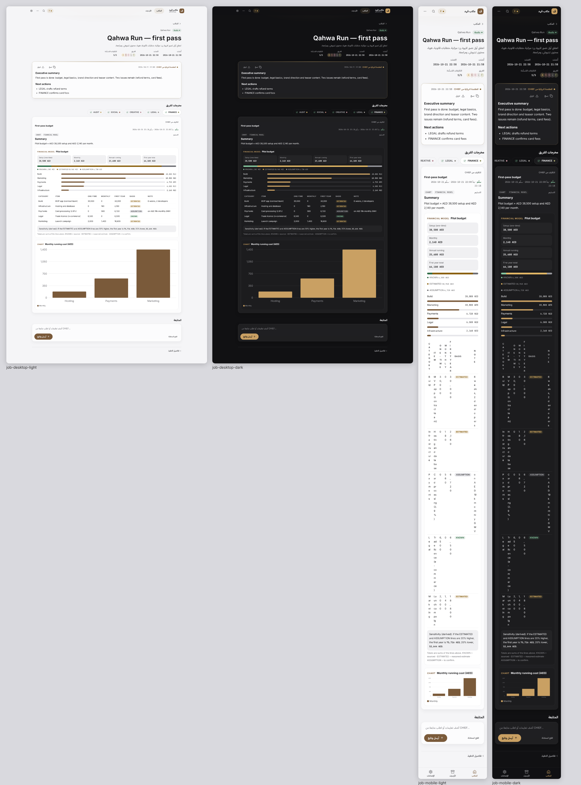
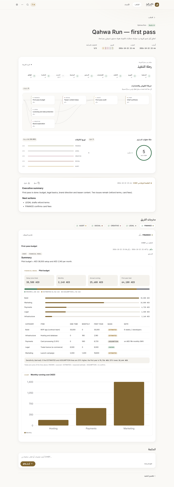

# Office premium V2.1 — Living execution, frontend only

Branch `feat/office-premium-v2-1`, based on deployed `main` at `56ff190e432939b0ec573b6807077978a602c46b`.

The follow-up visual polish and its refreshed 26-view screenshot matrix are documented in [office-premium-v2.1-polish.md](office-premium-v2.1-polish.md). PR #121 remains open for visual approval.

V2.1 is a presentation-only continuation of V2.0. It changes no database, migration, RPC, worker, model, prompt, routing, budget, permission or security rule. Production is not read beyond the public `/healthz`, and no production write or billable AI call is part of verification.

## Direction

Three directions were considered:

1. **Glass cockpit:** visually rich, but too much translucency competes with Arabic text and dense work.
2. **Operations graph:** maximally technical, but too cold for the daily executive home.
3. **Quiet living office (selected):** solid reading surfaces, glass only on navigation and overlays, true-data motion, and an Apple-like hierarchy that makes the current state understandable before it becomes decorative.

## Visual comparison

| V2.0 baseline | V2.1 quiet living office |
| --- | --- |
|  |  |
| Static execution detail below the synthesis | Recorded stages, dependency map, real workload/status charts and employee drill-down before the synthesis |

## What V2.1 adds

### A truthful execution journey

Job Detail now places a live execution journey before the final synthesis:

* the CHIEF stage rail comes from `objective.orchestration.steps`;
* the delegation map comes from `/api/workflows/:id` nodes;
* every drawn edge is an explicit `dependsOn` id — no inferred or decorative routes;
* active animation appears only when the recorded destination node is `working`;
* clicking an employee node opens that employee's existing owner-gated workspace sheet;
* the map renders at most 24 cards. If there are more, the UI says exactly how many are hidden and keeps the complete list under Execution details.

### Concise charts with real contracts

Two compact charts use the same workflow response:

* delivery-step state distribution: delivered, working, waiting, capacity and failed;
* assignments by employee, with delivered/total counts.

The charts show an explicit empty state before delegation. Cost is shown only when `job.costUsd` is recorded; otherwise it says unavailable. Handoff count is the actual `workflow.handoffs.length`.

### Sheets, decisions and live cues

* employee cards, map nodes, workload rows and deliverable panels open the existing employee side sheet;
* the side sheet is Arabic-first, keeps keyboard focus trapping and Escape close, uses a right/left desktop side sheet and a mobile bottom sheet;
* approval actions still call the existing `POST /api/approvals/:id` owner gate. Approval now receives a contextual native confirmation dialog describing the exact protected step before the existing write;
* running nodes and active dependency edges carry a restrained state cue. Reduced-motion removes those animations; state text and colour remain.

### Materials and accessibility

* content cards are solid; backdrop blur is limited to the top navigation, mobile navigation, side-sheet header and native decision dialog;
* `prefers-reduced-transparency`, `prefers-reduced-motion` and `prefers-contrast` keep their fallbacks;
* the map is keyboard-scrollable, employee nodes are buttons, stage progress uses `aria-current`, charts have labels/legends, and every animation has a text state.

## API and write boundary

V2.1 introduces no endpoint. It reads the existing V2.0 contracts and keeps the same writes:

* `POST /api/conversations`
* `POST /api/conversations/:id/messages`
* `POST /api/conversations/:id/stop`
* existing owner approval decision endpoint in `app.js`

There is no fake data in production. `tools/hub-preview.mjs` fixtures remain local-only and reach the real Hub handlers for visual and browser verification.

## Verification and known gap

Local verification (Windows, Node 24.19.0, Chrome) completed before opening the PR:

* focused UI, Office and redesign regression suite: **35/35 passed**;
* browser matrix: **16 axe-core views**, covering Office, Job Detail, Archive and Approvals at desktop/mobile × light/dark;
* browser result: **0 accessibility violations, 0 console errors and 0 page overflow**;
* interaction flow: **7/7 checks passed** — workflow map, employee side sheet, focus return, approval confirmation, reply, new objective and route navigation;
* visual record: the primary 16-view matrix plus desktop-light/mobile-dark evidence for employee sheet, approval confirmation, empty Office, planning and failed-job states under `docs/office-premium-v2.1/`;
* the full repository suite on Windows reported **749 passed, 24 skipped and 15 failed**. The failures are in the Coding Agent/Continuity OS-sandbox suites that invoke `bash` (`ENOENT: spawn bash`) or depend on their Linux process semantics; the V2.1 focused suite passes independently. The pull-request Linux CI is the authoritative full-suite gate.

The CSS and tests also cover reduced motion, reduced transparency, high contrast, true empty chart states, route preservation and the 24-node map budget.

The authenticated production screens remain **not verified** because production login requires a Supabase OTP. V2.1 exercises those screens only through local fictional fixtures and real handlers. Public production login/health can be checked without crossing that boundary.

Do not merge or deploy V2.1 without Fahad's explicit approval.
