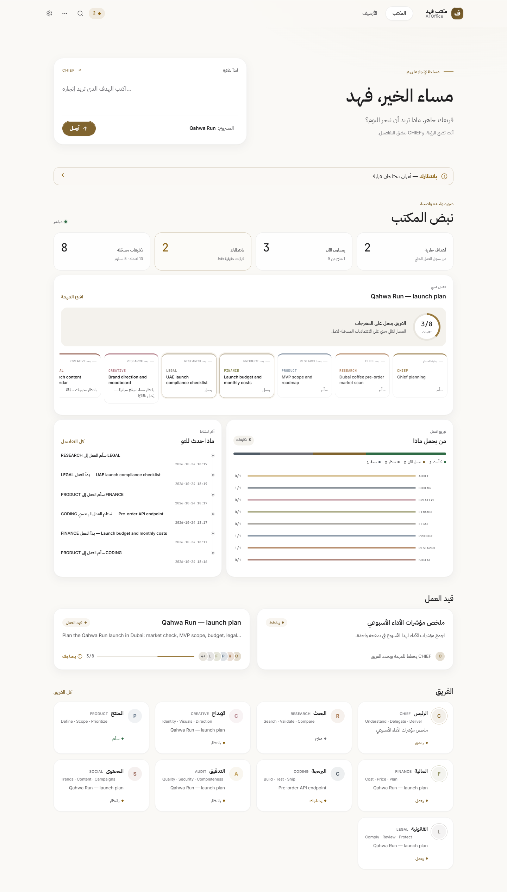
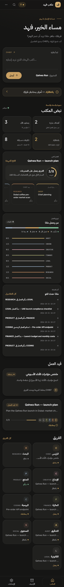

# Office V2.2 — Living Dashboard

Branch `feat/office-v2-2-living-dashboard`, based on the deployed V2.1 `main` commit `ce4cf8532cf11c0474ce1a327b92ddb0a333733a`.

V2.2 turns the Office homepage into a real-data executive dashboard. It is a frontend-only change: no database, migration, worker, model, prompt, routing, budget, security rule or owner gate changes.

## Before / after

| V2.1 homepage | V2.2 Living Dashboard |
| --- | --- |
|  |  |
|  |  |

The complete comparison includes desktop/mobile × light/dark under `docs/office-premium-v2.2/`.

## Truthful dashboard contract

The homepage reuses existing owner-gated read contracts:

- `/api/work/current` selects the currently open objectives;
- `/api/office` supplies recorded employee states and assignments;
- `/api/workflows/:id` supplies task nodes, explicit `dependsOn` relationships and handoffs;
- `/api/operations` supplies the selected objective's structured timeline;
- `/api/attention` supplies the real owner-decision count;
- `/api/work/sessions?scope=current` keeps existing standalone Coding work visible.

No dashboard metric is estimated. Assignment counts come only from workstream/development nodes. Dependency counts come only from explicit task ids. Empty and unavailable states stay explicit. The selected objective prefers a recorded multi-agent workflow; it never invents a route.

## Interaction and performance

- Four succinct at-a-glance indicators: current objectives, employees working now, real owner decisions and recorded assignments/dependencies/handoffs.
- A bounded delegation flow (10 visible nodes) with employee side-sheet drill-down and a direct job link.
- A recorded delivery fraction/stage, assignment-state distribution and clickable employee workload rows.
- A quiet six-entry activity timeline using non-technical structured operations events.
- Existing workflow graphs remain cached by objective signature. `/api/operations` is fetched only when the featured objective or its signature changes, not on every periodic refresh.
- The existing visibility-aware refresher remains: hidden tabs do not poll; live SSE uses a slow 120-second fallback; disconnected mode uses 30 seconds.
- Reduced motion removes the live pulse; light/dark, RTL/LTR, high contrast and reduced transparency retain their fallbacks.

## Verification

- Focused UI/Office suite: 72/72 passed.
- Browser matrix: 16 axe-core views across Office, Job Detail, Archive and Approvals at desktop/mobile × light/dark.
- Browser result: 0 accessibility violations, 0 console errors and 0 horizontal overflow.
- Interaction checks: 10/10 passed, covering the dashboard KPI strip, real dependency flow, dashboard employee side sheet/focus return, Job Detail map/stages/sheet, approval confirmation, Reply & Continue and new-objective submission.
- Screenshots use local fictional preview rows through the real Hub handlers. No production, Supabase, model or paid task is contacted.

Do not merge or deploy V2.2 without Fahad's explicit approval.
